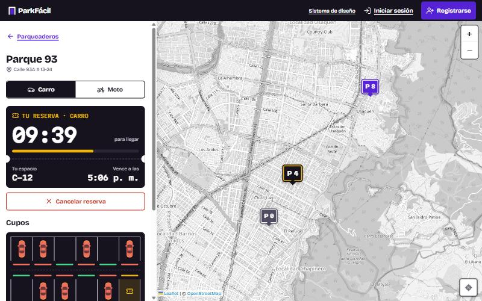
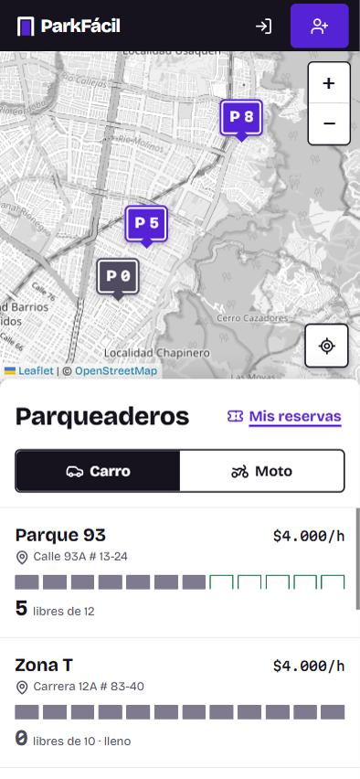

# ParkFácil

Plataforma SaaS multi-tenant de monitoreo, tarifas y reservas de parqueaderos.
Proyecto del curso Buenas Prácticas de Desarrollo de Software.

**App publicada:** <https://parkfacil.app>

| Carpeta            | Contenido                                |
| ------------------ | ---------------------------------------- |
| `apps/web`         | Frontend React (conductor y panel admin) |
| `services/api`     | Lambdas en TypeScript                    |
| `infra`            | Plantilla AWS SAM                        |
| `tools/sensor-sim` | Simulador de sensores                    |
| `tools/seed`       | Datos de prueba                          |
| `docs`             | Contrato de la API y guías               |

## Capturas

Tomadas con los datos de demostración (sin `NEXT_PUBLIC_API_URL`), en escritorio (1280 px) y teléfono (375 a 390 px).

| Landing | Detalle con reserva activa |
| --- | --- |
|  |  |

| Mapa en el teléfono | Mis reservas en el teléfono |
| --- | --- |
|  |  |

## Móvil y accesibilidad

El frontend del conductor se diseña primero para el teléfono y se revisó contra WCAG 2.1 nivel AA.

| Qué | Cómo se cumple |
| --- | --- |
| Pantallas pequeñas | Sin desplazamiento horizontal desde 375 px en landing, inicio de sesión, registro, mapa, detalle y Mis reservas |
| Zonas táctiles | Botones de 48 px de alto; enlaces y controles del mapa de 44 px como mínimo |
| Teclado | Todo se alcanza con Tab; el foco siempre se ve; "Saltar al contenido" es el primer elemento de cada página |
| Foco tras una acción | Al reservar o cancelar, el foco pasa al tiquete o al aviso; no vuelve al inicio de la página |
| Lector de pantalla | El contador se anuncia una vez por minuto, no cada segundo; los avisos usan `role="status"` o `role="alert"` |
| Sin depender del color | Cada estado (libre, reservado, ocupado, cumplida, vencida, cancelada) lleva icono o texto propio |
| Contraste | Texto con contraste de 4.5:1 o más; el amarillo nunca se usa como color de texto sobre fondo claro |
| Título de la pestaña | Cada pantalla tiene el suyo: "Mis reservas · ParkFácil", "Parque 93 · ParkFácil" |
| Movimiento | Las animaciones se apagan con `prefers-reduced-motion` |
| Idioma | `lang="es"` en el documento |

Cómo se revisó: recorrido con teclado, lectura del árbol de accesibilidad y una auditoría por script
en el navegador (desbordes, tamaño de las zonas táctiles, nombres accesibles, etiquetas de los
campos, orden de los encabezados y contraste) en cada pantalla a 375 px. No se probó con un lector
de pantalla real ni en un teléfono físico.

## Getting Started

### Requisitos previos
- **Node.js** 22 o superior (verificado en `.nvmrc`) y **npm** 10+
- **Git** configurado con acceso de colaborador al repositorio
- **Docker** (opcional, para ejecutar DynamoDB Local en las pruebas de integración)
- **AWS CLI** y **AWS SAM CLI** (para despliegue de infraestructura en AWS)

### Instalación y ejecución local contra el Learner Lab
1. Clonar el repositorio e instalar las dependencias desde la raíz:
   ```bash
   git clone https://github.com/Sebas200702/parkfacil.git
   cd parkfacil
   npm install
   ```

## Build, despliegue y dominio en producción

- **Aplicación en producción:** <https://parkfacil.app>
- **Distribución y DNS:** Amazon S3 (Static Website Hosting) + Cloudflare (DNS, caché perimetral y certificado SSL/TLS)

### Construcción del frontend (exportación estática)
El frontend en Next.js está configurado con `output: 'export'` en `apps/web/next.config.ts` para generar archivos estáticos compatibles con S3:

```bash
npm run build -w @parkfacil/web
```
Esto genera el directorio `apps/web/out/` listo para sincronizarse con el bucket S3.

### Despliegue en AWS Academy Learner Lab
1. **Backend e infraestructura (AWS SAM):**
   ```bash
   cd infra
   sam build
   sam deploy --no-confirm-changeset
   ```
2. **Sincronización del frontend en S3:**
   ```bash
   aws s3 sync apps/web/out/ s3://<NOMBRE_BUCKET_FRONTEND> --delete
   ```

## Flujo operativo y estructura del sistema

### Ciclo de operación
1. **Conductor:** Consulta disponibilidad en tiempo real por parqueadero, crea una reserva activa por **15 minutos** y recibe un tiquete digital con código único.
2. **Sensores IoT (MQTT):** Los dispositivos físicos (o el simulador `tools/sensor-sim`) publican eventos de ocupación por bahía hacia **AWS IoT Core**, actualizando el estado en **DynamoDB**.
3. **Vencimiento automático:** Una regla programada en **Amazon EventBridge** ejecuta una función Lambda periódica que libera automáticamente las reservas no reclamadas tras cumplirse los 15 minutos.
4. **Administrador:** Gestiona tarifas dinámicas, parqueaderos, bahías y métricas operativas desde el panel administrativo autenticado con **Amazon Cognito**.

### Arquitectura y recursos AWS
- **Frontend estático y dominio:** Amazon S3 (Static Website Hosting) + Cloudflare (DNS, HTTPS y caché perimetral) en <https://parkfacil.app>.
- **API y cómputo:** Amazon API Gateway (HTTP API) + AWS Lambda (Node.js 22 / TypeScript).
- **Persistencia y autenticación:** Amazon DynamoDB (diseño single-table con bloqueo optimista para evitar doble reserva) + Amazon Cognito User Pools.
- **Telemetría y tareas programadas:** AWS IoT Core + Amazon EventBridge. 
