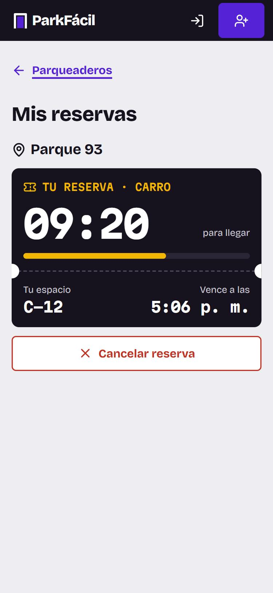

# ParkFácil

Plataforma SaaS multi-tenant de monitoreo, tarifas y reservas de parqueaderos.
Proyecto del curso Buenas Prácticas de Desarrollo de Software.

**App publicada:** <https://parkfacil.app>

| Carpeta            | Contenido                                |
| ------------------ | ---------------------------------------- |
| `apps/web`         | Frontend React (conductor y panel admin) |
| `services/api`     | Lambdas en TypeScript                    |
| `infra`            | Plantilla AWS SAM                        |
| `tools/sensor-sim` | Simulador de sensores                    |
| `tools/seed`       | Datos de prueba                          |
| `docs`             | Contrato de la API y guías               |

## Capturas

Tomadas con los datos de demostración (sin `NEXT_PUBLIC_API_URL`), en escritorio (1280 px) y teléfono (375 a 390 px).

| Landing | Detalle con reserva activa |
| --- | --- |
|  |  |

| Mapa en el teléfono | Mis reservas en el teléfono |
| --- | --- |
|  |  |

## Móvil y accesibilidad

El frontend del conductor se diseña primero para el teléfono y se revisó contra WCAG 2.1 nivel AA.

| Qué | Cómo se cumple |
| --- | --- |
| Pantallas pequeñas | Sin desplazamiento horizontal desde 375 px en landing, inicio de sesión, registro, mapa, detalle y Mis reservas |
| Zonas táctiles | Botones de 48 px de alto; enlaces y controles del mapa de 44 px como mínimo |
| Teclado | Todo se alcanza con Tab; el foco siempre se ve; "Saltar al contenido" es el primer elemento de cada página |
| Foco tras una acción | Al reservar o cancelar, el foco pasa al tiquete o al aviso; no vuelve al inicio de la página |
| Lector de pantalla | El contador se anuncia una vez por minuto, no cada segundo; los avisos usan `role="status"` o `role="alert"` |
| Sin depender del color | Cada estado (libre, reservado, ocupado, cumplida, vencida, cancelada) lleva icono o texto propio |
| Contraste | Texto con contraste de 4.5:1 o más; el amarillo nunca se usa como color de texto sobre fondo claro |
| Título de la pestaña | Cada pantalla tiene el suyo: "Mis reservas · ParkFácil", "Parque 93 · ParkFácil" |
| Movimiento | Las animaciones se apagan con `prefers-reduced-motion` |
| Idioma | `lang="es"` en el documento |

Cómo se revisó: recorrido con teclado, lectura del árbol de accesibilidad y una auditoría por script
en el navegador (desbordes, tamaño de las zonas táctiles, nombres accesibles, etiquetas de los
campos, orden de los encabezados y contraste) en cada pantalla a 375 px. No se probó con un lector
de pantalla real ni en un teléfono físico.

## Getting Started

### Requisitos previos
- **Node.js** 22 o superior (verificado en `.nvmrc`) y **npm** 10+
- **Git** configurado con acceso de colaborador al repositorio
- **Docker** (opcional, para ejecutar DynamoDB Local en las pruebas de integración)
- **AWS CLI** y **AWS SAM CLI** (para despliegue de infraestructura en AWS)

### Instalación y ejecución local contra el Learner Lab
1. Clonar el repositorio e instalar las dependencias desde la raíz:
   ```bash
   git clone [https://github.com/Sebas200702/parkfacil.git](https://github.com/Sebas200702/parkfacil.git)
   cd parkfacil
   npm install
   
