<!--
  The poster-style panels in this README are images in docs/readme/. They are drawn with the app's own
  design system (tokens, fonts, Lucide icons, bay plan, ticket) by tools/readme-assets.
  To change one, edit its page in tools/readme-assets/pages and run:
    node tools/readme-assets/render.mjs
-->

<h1 align="center">
  <a href="https://parkfacil.app">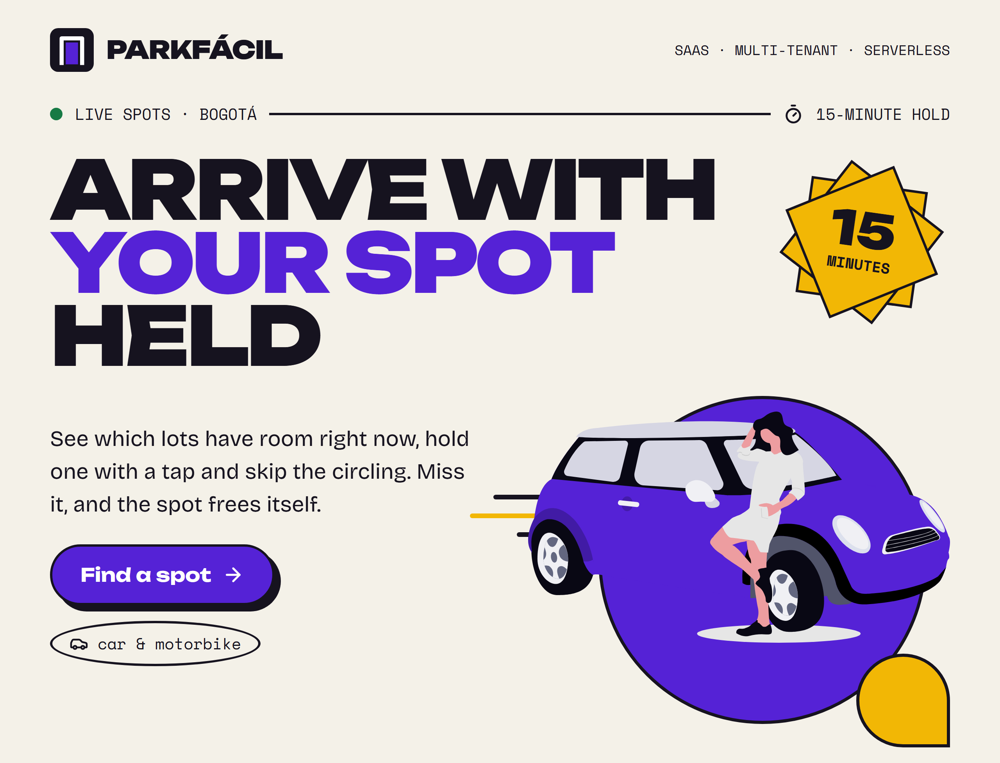</a>
</h1>

<p align="center">
  <a href="https://parkfacil.app">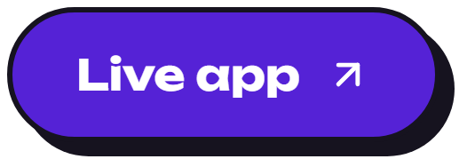</a>
  <a href="#getting-started">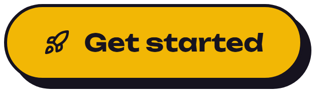</a>
  <a href="docs/arquitectura.md">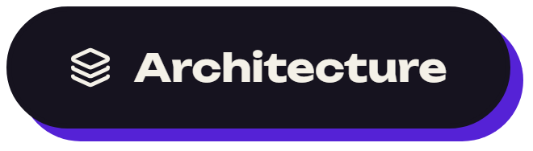</a>
  <a href="docs/api.md">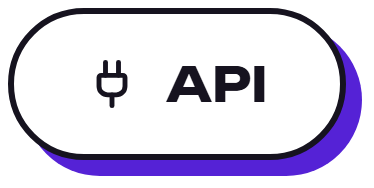</a>
  <a href="docs/despliegue.md">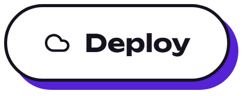</a>
</p>

<p align="center">
  <a href="https://github.com/Sebas200702/parkfacil/actions/workflows/ci.yml"></a>
</p>

**ParkFácil** is a multi-tenant SaaS platform for live parking availability, rates and reservations.
Drivers see which lots have room, hold a spot for 15 minutes and walk in with a ticket. Lot
operators watch occupancy in real time and manage their own rates. A held spot that nobody claims
frees itself.

It is a course project for *Software Development Best Practices* (Buenas Prácticas de Desarrollo de Software).

> **Language note.** The product, its screens and the long-form documents in `docs/` are in
> Colombian Spanish, because that is who the app is for. This README, the code, the commits and the
> pull requests are in English.

<p align="center">
  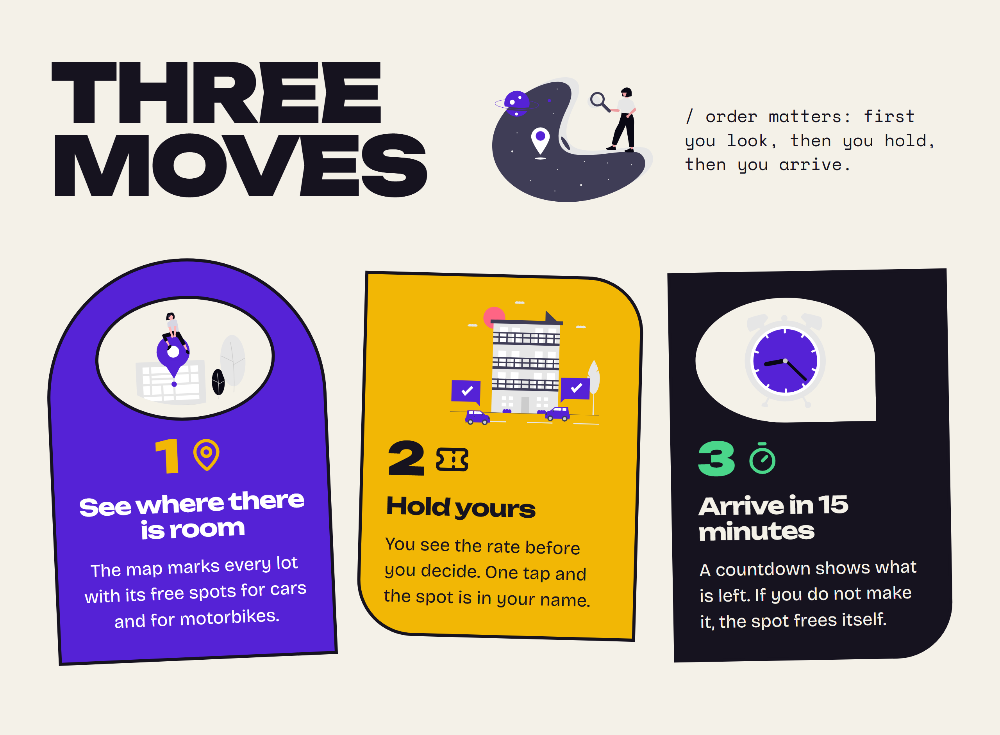
</p>

<p align="center">
  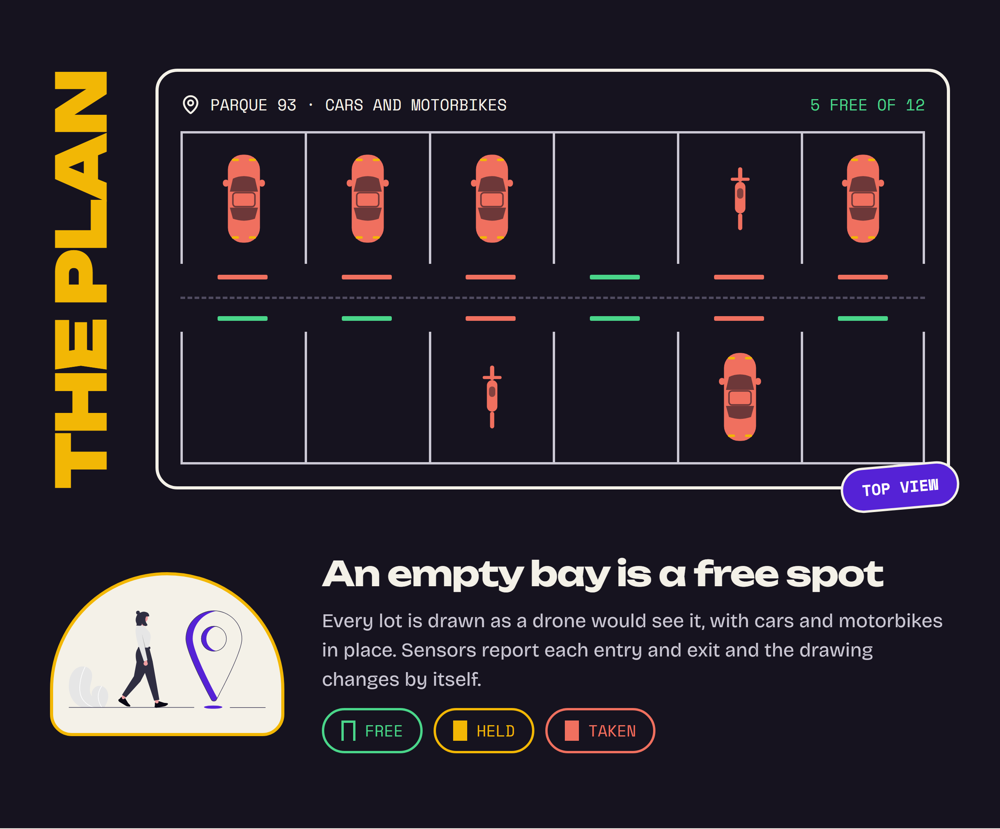
</p>

<p align="center">
  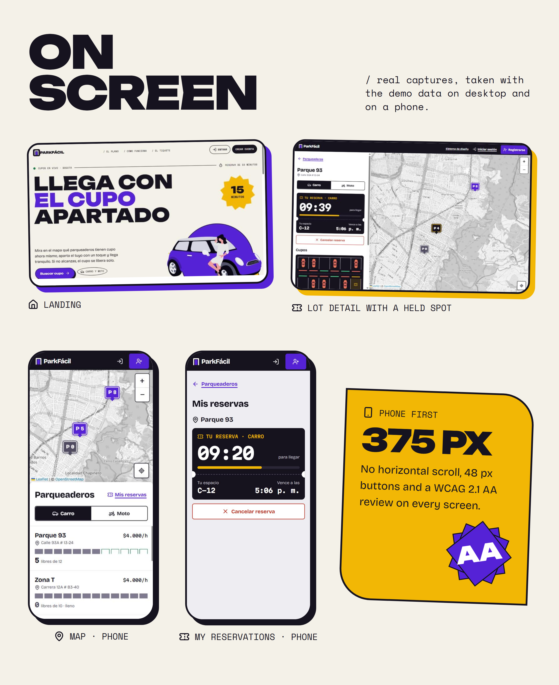
</p>

<h2 id="accessibility" align="center">
  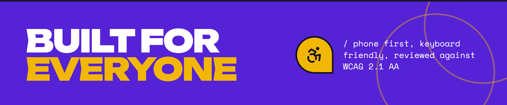
</h2>

<p align="center">
  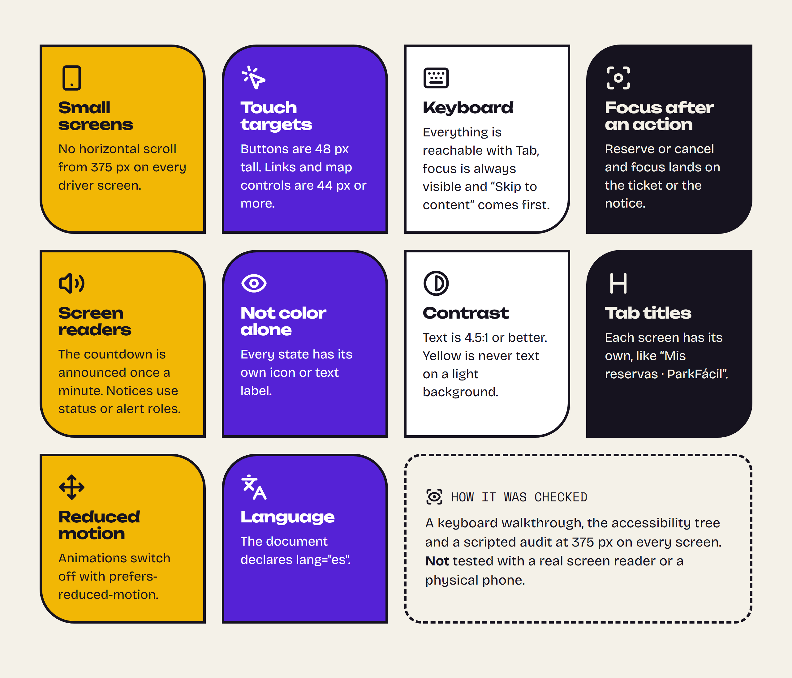
</p>

<details>
<summary>The same checklist as text</summary>

| Area | How it is met |
| --- | --- |
| Small screens | No horizontal scrolling from 375 px on the landing, sign-in, sign-up, map, detail and My reservations screens |
| Touch targets | Buttons are 48 px tall. Links and map controls are at least 44 px |
| Keyboard | Everything is reachable with Tab, focus is always visible, and "Skip to content" is the first element on every page |
| Focus after an action | After reserving or cancelling, focus moves to the ticket or the notice instead of jumping back to the top |
| Screen readers | The countdown is announced once a minute, not every second. Notices use `role="status"` or `role="alert"` |
| Not color alone | Every state (free, held, taken, fulfilled, expired, cancelled) has its own icon or text |
| Contrast | Text has a contrast ratio of 4.5:1 or more. Yellow is never used as text on a light background |
| Tab titles | Every screen has its own, such as "Mis reservas · ParkFácil" |
| Motion | Animations are switched off with `prefers-reduced-motion` |
| Language | `lang="es"` on the document |

**How it was checked:** a keyboard walkthrough, reading the accessibility tree, and a scripted audit in
the browser (overflow, touch target size, accessible names, field labels, heading order and contrast)
on every screen at 375 px. It has **not** been tested with a real screen reader or on a physical phone.

</details>

<h2 id="architecture" align="center">
  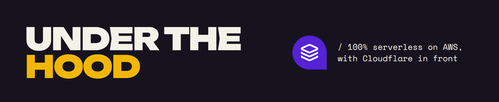
</h2>

<p align="center">
  
</p>

<p align="center">
  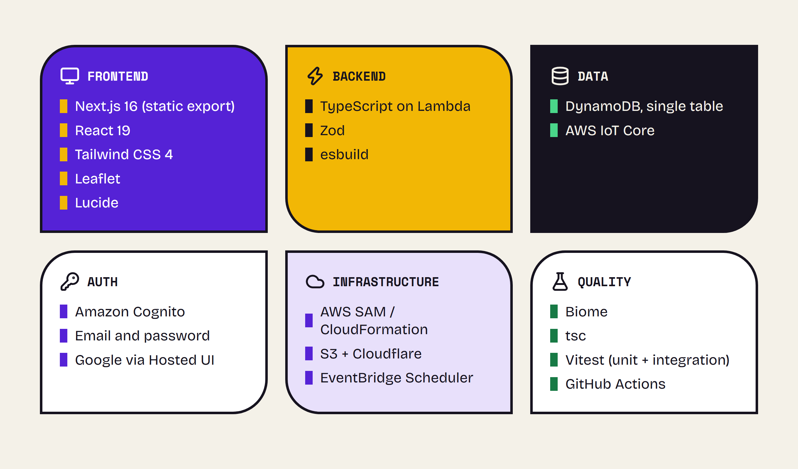
</p>

The detailed diagram, the data model and the decisions behind them are in
[`docs/arquitectura.md`](docs/arquitectura.md).

<h2 id="getting-started" align="center">
  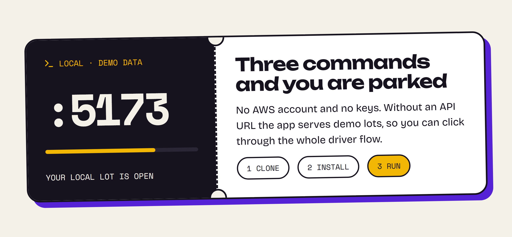
</h2>

<h3>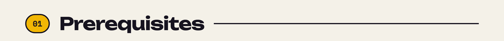</h3>

- **Node.js** 22 or newer (see `.nvmrc`) and **npm** 10+
- **Git**
- **Docker** (optional): DynamoDB Local for the integration tests
- **AWS CLI** v2 (only to deploy)

<h3>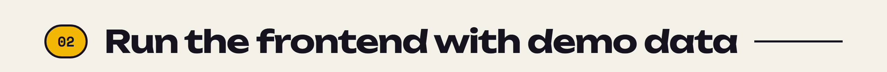</h3>

No account or cloud resources needed. Without an API URL the app serves built-in demo parking lots.

```bash
git clone https://github.com/Sebas200702/parkfacil.git
cd parkfacil
npm install
npm run dev -w @parkfacil/web
```

Open <http://localhost:5173>. The gallery of base components is at <http://localhost:5173/ui>.

<h3>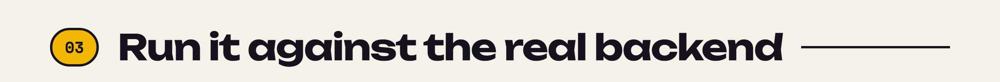</h3>

Copy the example environment file and fill it in with the outputs of the deployed stack
(see [`docs/despliegue.md`](docs/despliegue.md), section 3):

```bash
cp apps/web/.env.example apps/web/.env.local
```

| Variable | Stack output | Notes |
| --- | --- | --- |
| `NEXT_PUBLIC_API_URL` | `ApiUrl` | Use `/api` locally together with `API_PROXY_TARGET` |
| `API_PROXY_TARGET` | `ApiUrl` | Development only. Proxies `/api` to avoid CORS |
| `NEXT_PUBLIC_COGNITO_USER_POOL_ID` | `UserPoolId` | Without it, no sign-in is required |
| `NEXT_PUBLIC_COGNITO_CLIENT_ID` | `UserPoolClientId` | |
| `NEXT_PUBLIC_COGNITO_DOMAIN` | `CognitoDomain` | Needed for "Continue with Google" |

These are public identifiers, not secrets. Demo users are listed in [`docs/despliegue.md`](docs/despliegue.md).

<h3>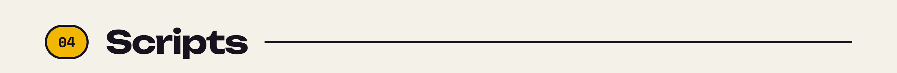</h3>

Run these from the repository root.

| Command | What it does |
| --- | --- |
| `npm run lint` | Biome check on the whole repository |
| `npm run format` | Biome check with automatic fixes |
| `npm run typecheck` | `tsc` in every workspace |
| `npm test` | Unit tests (Vitest) |
| `npm run db:local` | Starts DynamoDB Local in Docker on port 8000 |
| `npm run test:int` | Integration tests. Needs `DYNAMODB_ENDPOINT=http://localhost:8000` |
| `npm run test:e2e -w @parkfacil/web` | Playwright test of the landing, sign-in and reserve flow. Needs `npx playwright install chromium` once |
| `npm run build` | Builds the frontend (`apps/web/out`) and bundles the Lambdas |
| `npm run emulator:start`, `emulator:deploy`, `emulator:smoke` | Try the whole stack locally in AWS Emulator |

<h3>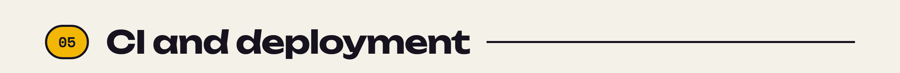</h3>

- **CI** ([`ci.yml`](.github/workflows/ci.yml)) runs on every pull request and on pushes to `main`:
  lint, `cfn-lint` on the template, typecheck, unit tests, integration tests against DynamoDB Local,
  the Playwright reservation flow, and build.
- **Deploy** ([`deploy.yml`](.github/workflows/deploy.yml)) runs after each merge to `main`. It
  deploys the CloudFormation stack, builds the frontend with the stack outputs and syncs it to S3.
- The site is a static export served from S3 behind Cloudflare. The full steps for the AWS Academy
  Learner Lab, the custom domain and Google sign-in are in [`docs/despliegue.md`](docs/despliegue.md).

<h2 id="repository-layout" align="center">
  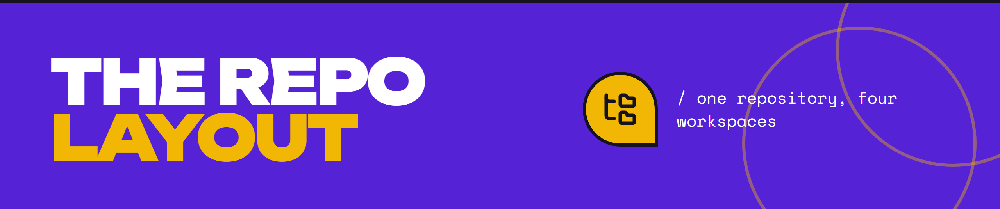
</h2>

<p align="center">
  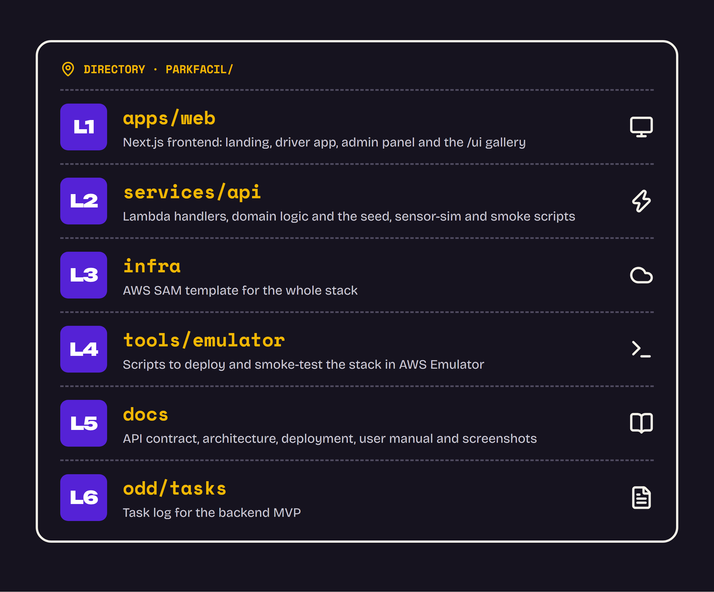
</p>

<h2 id="documentation" align="center">
  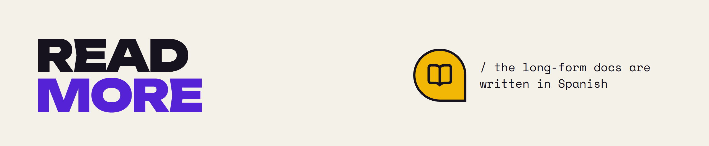
</h2>

| Document | Language | About |
| --- | --- | --- |
| [`docs/sistema-de-diseno.md`](docs/sistema-de-diseno.md) | Spanish | The design system behind the app and this README |
| [`docs/arquitectura.md`](docs/arquitectura.md) | Spanish | Architecture, diagram and decisions |
| [`docs/api.md`](docs/api.md), [`docs/openapi.yaml`](docs/openapi.yaml) | Spanish | API contract |
| [`docs/despliegue.md`](docs/despliegue.md) | Spanish | Emulator, Learner Lab, domain and Google sign-in |
| [`docs/ci-cd.md`](docs/ci-cd.md) | Spanish | The CI and deploy pipelines in detail |
| [`docs/guia-sensores.md`](docs/guia-sensores.md) | Spanish | How to simulate sensors over MQTT or HTTP and check the result |
| [`docs/checklist-qa.md`](docs/checklist-qa.md) | Spanish | Automated and manual QA checklist |
| [`docs/manual-usuario.md`](docs/manual-usuario.md) | Spanish | User manual for drivers and admins |
| [`docs/uso-de-ia.md`](docs/uso-de-ia.md) | Spanish | How AI was used and how it was verified |

<h2 id="contributing" align="center">
  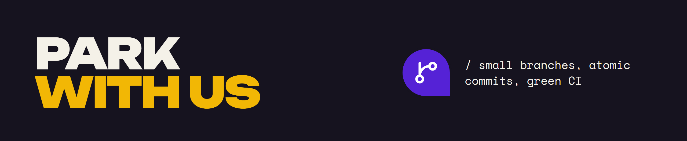
</h2>

- Work on a `feature/*` branch and open a pull request against `main`. Keep pull requests small
  (around 400 lines) and follow the [pull request template](.github/pull_request_template.md).
- Write commits and pull requests in English, as small atomic
  [Conventional Commits](https://www.conventionalcommits.org) (`feat(web): ...`, `fix(api): ...`).
- Every change needs green CI and a review by another team member before it is merged.
- Never commit AWS credentials. Lab credentials only go in GitHub secrets.
- The pictures in this README come from [`tools/readme-assets`](tools/readme-assets). Edit the page
  there and run `node tools/readme-assets/render.mjs` to redraw them (needs Chrome and `npm install`).

<p align="center">
  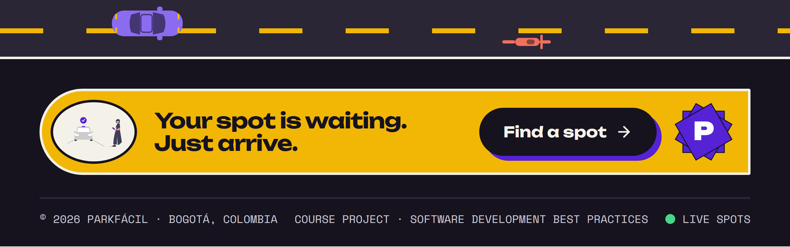
</p>
