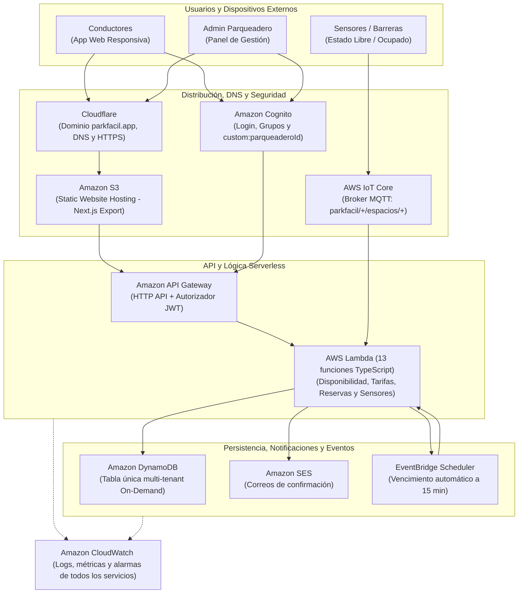

# Arquitectura del Sistema — ParkFácil

ParkFácil implementa una arquitectura **100 % serverless multi-tenant** desplegada en **AWS (región `us-east-1`)** y protegida perimetralmente mediante **Cloudflare** para gestión de dominio personalizado (`https://parkfacil.app`), DNS y cifrado TLS/HTTPS.

## 1. Diagrama de Arquitectura

## Justificación de servicios AWS y restricciones del Learner Lab

| Servicio | Función en ParkFácil | Justificación técnica y restricciones del entorno |
| :--- | :--- | :--- |
| **Amazon S3 (Website)** | Aloja el frontend estático compilado (`HTML`, `CSS`, `JS`). | Sin servidor y bajo costo. Se sirve directamente desde S3 porque el Learner Lab bloquea `cloudfront:CreateOriginAccessControl` y las OAI. |
| **Cloudflare** | Resolución DNS del dominio propio (`parkfacil.app`) y cifrado HTTPS. | El endpoint de S3 Website solo soporta HTTP; Cloudflare actúa como proxy inverso (SSL modo *Flexible*) con certificado gratuito sin depender de la sesión temporal del lab. |
| **Amazon Cognito** | Registro, autenticación y control de acceso por grupos (`conductor` y `admin`) con atributo `custom:parqueaderoId`. | Autenticación administrada; API Gateway valida la firma, emisor y audiencia del JWT antes de invocar cualquier Lambda. |
| **API Gateway (HTTP API)** | Expone los endpoints REST (`GET /parqueaderos` público y rutas protegidas). | Menor latencia y costo que REST API, con autorizador JWT nativo integrado. |
| **AWS Lambda** | Ejecuta la lógica de negocio (13 funciones en Node.js 22 / TypeScript). | Modelo de pago por invocación sin costos fijos por hora, optimizado para el presupuesto de USD 50 del laboratorio. |
| **Amazon DynamoDB** | Persistencia en diseño de una sola tabla (`PARQ#...`, `META`, `ESPACIO#`, `RESERVA#`, `EVENTO#`) con índices `GSI1`, `GSI2` y `TTL`. | Capacidad *on-demand*, soporte para transacciones condicionales (`TransactWriteItems`) y expiración automática de registros históricos. |
| **AWS IoT Core** | Recibe telemetría de ocupación por MQTT en el tópico `parkfacil/{{parqueaderoId}}/espacios/{{espacioId}}`. | Protocolo estándar IoT; una regla enruta cada mensaje directamente a la función Lambda `sensor-iot`. |
| **EventBridge Scheduler** | Programa la liberación automática de cada reserva exactamente a los 15 minutos. | Ejecución precisa por reserva creada, respaldada por una regla de barrido cada minuto. |
| **Amazon SES** | Envía el correo electrónico de confirmación de reserva al conductor. | Implementado bajo patrón *best-effort*: si falla o el correo no está verificado en sandbox, el error se registra en CloudWatch sin revertir la reserva. |
| **CloudFormation / AWS SAM** | Define toda la infraestructura como código en `infra/template.yaml`. | Permite reconstruir el stack completo de forma reproducible en cualquier sesión del laboratorio. |
| **IAM (`LabRole`)** | Rol de ejecución asignado a todas las funciones Lambda y servicios. | AWS Academy Learner Lab restringe la creación de nuevos roles IAM (`iam:CreateRole`), por lo que todos los recursos utilizan el rol preexistente `LabRole`. |

## Reglas de negocio críticas

1. **Prevención de sobre-reserva (concurrencia):** Cada reserva ejecuta una transacción condicional en DynamoDB (`TransactWriteItems`) que descuenta el cupo únicamente si `cupos > 0` y cambia el estado del espacio de `LIBRE` a `RESERVADO`. Ante peticiones simultáneas sobre el último cupo, las solicitudes excedentes reciben `409 Conflict` (`Sin cupos`).
2. **Aislamiento multi-tenant:** Las funciones administrativas extraen el identificador `custom:parqueaderoId` directamente de los *claims* verificados del token JWT de Cognito (nunca del cuerpo de la petición), impidiendo que un administrador consulte o modifique otro parqueadero.
3. **Ciclo de vida y tarificación de reservas:** Cada conductor puede mantener máximo una reserva activa, la cual vence automáticamente tras **15 minutos** mediante EventBridge Scheduler o pasa a estado `CUMPLIDA` cuando el sensor IoT detecta ocupación. El cálculo de tarifa aplica horas completas más fracciones de 15 minutos con tope máximo en `valorDia`.
